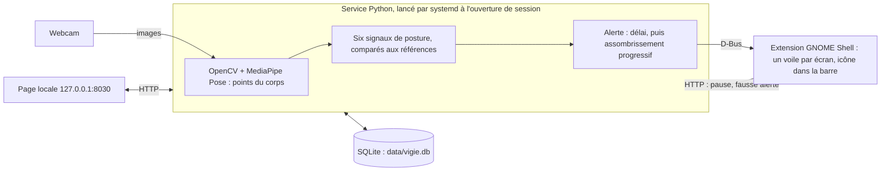

# Vigie

Surveillance de la posture par la webcam, sur un bureau Linux (GNOME) : quand on reste
avachi trop longtemps, l'écran s'assombrit, et redevient normal d'un coup dès qu'on se
redresse.

> **In English** — Vigie watches your posture through the webcam on a GNOME (Wayland)
> desktop and dims the screen while you slouch, until you sit up again. A local Python
> service (FastAPI, OpenCV, MediaPipe Pose) compares six posture signals with reference
> postures you record yourself; a GNOME Shell extension draws the overlay. No image is stored.

[](https://github.com/MichelDM974/Vigie/actions/workflows/ci.yml)

## Le concept

Une remarque ou une notification s'ignore vite ; un écran qui baisse, beaucoup moins.
Vigie tourne en tâche de fond dès l'ouverture de session et compare en permanence la
posture à des **postures de référence que l'utilisateur enregistre lui-même** : droit au
clavier, adossé en lisant, tourné vers le second écran… Tant qu'on ressemble à l'une
d'elles, rien ne se passe. Au-delà de quelques secondes d'écart continu (10 au plus), un
voile sombre descend sur l'écran, et il se lève dès que la posture redevient correcte.

## Architecture



## Approche technique

- **Points du corps** : [MediaPipe Pose](https://ai.google.dev/edge/mediapipe/solutions/vision/pose_landmarker)
  (modèle *full*, sur le processeur) repère le nez, les yeux, les oreilles et les
  épaules, 5 fois par seconde ; une seule après deux minutes sans personne à l'image,
  le temps que quelqu'un revienne (la caméra ne décode alors que 2 images par seconde).
- **Signaux de posture** : une caméra de face ne voit pas la courbure du dos, seulement
  ses conséquences. Vigie en tire six rapports sans unité : tête et nez au-dessus des
  épaules, hauteur de la tête dans l'image, proximité de l'écran, tête en avant du buste,
  inclinaison des épaules. Ils sont lissés par une médiane glissante sur 0,6 s (3 mesures) :
  un redressement se voit en ~0,3 s.
- **Comparaison** : chaque signal est ramené à sa tolérance. La posture de référence la
  plus proche fait foi, et seuls comptent les écarts dans le mauvais sens : se tenir plus
  droit que sa référence n'est jamais puni.
- **Alerte** : il faut 10 s d'écart continu (réglable de 0 à 10 s) avant que le voile ne
  descende, en 3 s (réglable de 0 à 10 s, 0 = d'un coup). Un redressement d'une seconde ne
  remet pas le compte à zéro, mais éclaircit l'écran aussitôt et d'un coup, sans fondu.
- **Assombrissement** : sous Wayland, une application ne peut pas se placer au-dessus de
  tout, et le rétroéclairage des écrans externes ne se règle pas par logiciel. Une petite
  extension GNOME Shell pose donc un voile sur chaque écran, avec un assombrissement
  maximal propre à chacun (un écran plus lumineux demande un voile plus sombre). Les clics
  le traversent,
  et il couvre aussi les fenêtres plein écran. Le service lui parle par D-Bus. Si
  l'extension reste 6 s sans nouvelles, elle retire le voile : un service planté ne laisse
  jamais l'écran sombre.

## Pile technique

- **Service** : Python 3.14, FastAPI et uvicorn, OpenCV, MediaPipe ; service systemd
  utilisateur. Versions figées dans `constraints.txt`.
- **Page locale** : HTML, CSS et JavaScript sans framework.
- **Données** : SQLite (`data/vigie.db`).
- **Extension** : JavaScript (GJS) pour GNOME Shell 49-50, D-Bus.
- **Qualité** : pytest, intégration continue sur GitHub Actions (tests et vérification
  de la syntaxe de l'extension).

## Fonctionnalités

- Page locale (http://127.0.0.1:8030) :
  - aperçu de la caméra en miroir avec les points suivis ;
  - état en direct et écart de chaque signal ;
  - enregistrement des postures de référence (compte à rebours, puis 3 s de capture) ;
  - bilan du jour : temps passé droit, avachi, absent et en pause, et temps avachi
    réparti par cause (le signal qui dépassait le plus).
- Icône dans la barre du haut : état, interrupteur de surveillance, ouverture de la page.
- Fausse alerte : écran assombri alors qu'on se tient droit → un clic (menu de l'icône,
  page ou commande) retire le voile jusqu'au prochain redressement et note les mesures
  du moment, de quoi recaler les tolérances sur les vraies erreurs.
- Pause qui libère vraiment la caméra, pour les visios (sous Linux, une seule application
  peut filmer à la fois).
- Réglages : tolérance générale, délai avant d'assombrir, durée d'assombrissement,
  assombrissement maximal de chaque écran, bouton de test.
- Vie privée : aucune image n'est enregistrée (seulement les mesures des postures de
  référence et des fausses alertes, et le temps passé dans chaque état). La page n'écoute que sur 127.0.0.1.

## Installation

Prérequis : Linux avec GNOME Shell 49 ou 50 (Wayland), Python 3.14, une webcam.

```bash
scripts/installer.sh
```

Le script :

1. crée l'environnement Python et y installe les dépendances aux versions figées de
   `constraints.txt` ;
2. copie et active l'extension GNOME, et réactive les extensions utilisateur si GNOME
   les a toutes coupées (il le fait après un plantage de GNOME Shell au démarrage) ;
3. installe le service systemd utilisateur `vigie.service` et le démarre.

À la première installation, fermer puis rouvrir la session une fois : sous Wayland, GNOME
ne charge une nouvelle extension qu'à l'ouverture de session. Ouvrir ensuite
http://127.0.0.1:8030 et enregistrer au moins une posture de référence.

Au premier lancement, le service télécharge le modèle Pose Landmarker de Google
(`pose_landmarker_full.task`, environ 9 Mo) dans `models/`.

Le script est relançable après une mise à jour. `scripts/desinstaller.sh` retire le
service et l'extension, mais garde `data/`.

Commandes utiles, par exemple pour un raccourci clavier GNOME :

```bash
PYTHONPATH=src .venv/bin/python -m vigie basculer   # pause ↔ reprise
PYTHONPATH=src .venv/bin/python -m vigie fausse-alerte   # « je suis droit »
PYTHONPATH=src .venv/bin/python -m vigie etat
```

Essayer sans webcam ni extension (caméra factice, personne à l'image ; aucun voile ;
base jetable), sur un autre port que le vrai service :

```bash
PYTHONPATH=src .venv/bin/python -m vigie serve --camera factice --sans-ecran --port 8031 --data /tmp/vigie-essai
```

## Structure du dépôt

```
src/vigie/
  camera.py      lecture de la webcam dans un fil à part (et caméra factice)
  detection.py   points du corps par MediaPipe Pose
  posture.py     les six signaux et la comparaison aux postures de référence
  alerte.py      quand et combien assombrir, d'après la suite des états
  moteur.py      boucle : image → points → posture → assombrissement
  ecran.py       messages D-Bus à l'extension GNOME Shell
  stockage.py    base SQLite : postures, réglages, temps passé dans chaque état
  web.py         API et page locale (FastAPI, limitée aux requêtes locales)
src/static/      page locale
gnome-extension/ extension GNOME Shell (voile et icône d'état)
scripts/         installation et désinstallation
tests/           tests pytest
.claude/skills/run-vigie/   outillage de l'assistant de code (voir « Méthode »)
```

## Tests

```bash
.venv/bin/pip install -r requirements-dev.txt -c constraints.txt
.venv/bin/pytest -q
```

Les tests tournent sans webcam ni GNOME : caméra et écran y sont simulés.

## Méthode

Ce projet est développé avec Claude Code, l'assistant de programmation d'Anthropic : il
écrit l'essentiel du code, d'où la mention « Co-Authored-By: Claude » des commits. Mon
travail : définir ce que fait l'outil et pour qui, trancher les choix de conception (un
voile plutôt qu'une notification, une caméra de face, un voile par écran), fixer les
critères qui valident un changement, et me servir de Vigie au quotidien : les tolérances
ont été calées sur mes propres postures de référence, et chaque fausse alerte signalée
d'un clic sert à les recaler sur les vraies erreurs. Le dossier `.claude/skills/run-vigie/`
est l'outillage qui permet à l'assistant de lancer Vigie avec une caméra factice, de le
piloter et de photographier la page lui-même avant de rendre son travail. Les numéros #N
des messages de commit renvoient à mon suivi de tickets personnel, qui n'est pas public.

## Licence

Code sous licence MIT (voir [`LICENSE`](LICENSE)). La police Inter, embarquée dans
`src/static/vendor/inter/`, est sous licence SIL Open Font License (voir son
`LICENSE.txt`) ; le modèle MediaPipe, téléchargé au premier lancement, n'est pas dans le
dépôt.
